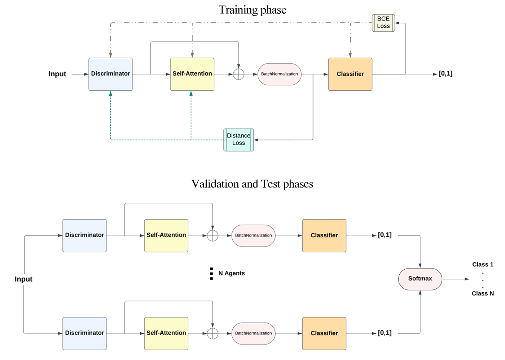

# Explainable Multi-Agent Network for Multi-Classification in Small Tabular Data

Code accompanying: Bouskri, M., Idrissi, A. (2024). Explainable Multi-agent Network for Multi-classification in Small Tabular Data. In: Idrissi, A. (eds) Modern Artificial Intelligence and Data Science 2024. Studies in Computational Intelligence, vol 1166. Springer, Cham. https://doi.org/10.1007/978-3-031-65038-3_5


## Overview

Deep learning has gained tremendous success in recent years in most data types, but still outperformed by classical machine learning on tabular datasets, the most common data type, especially smaller ones. An explainable deep learning model with accurate prediction power on tabular datasets can make it easier to use the advantages of such methods to allow more flexibility in architecture design to be applied on this type of data, the use of transfer learning on similar tasks, and build trust in model predictions. We present an explainable multi-agent network for multi-classification of small tabular datasets, that uses a discrimination network, an attention block, and a classification network. Our model has an accuracy close to the best results of OpenML benchmark with an average difference of 4.2%, and outperformed a similar deep learning approach in accuracy.

**Method.** For a problem with C classes, C models are trained in parallel (one per
class, one-vs-rest). Each model has three parts:
1. a **discriminator** that embeds each feature value,
2. an **attention** layer with a residual connection,
3. a **classifier** that outputs a class score.

At prediction time the C scores are combined with a softmax, and attention weights are aggregated per class into feature-importance heatmaps.



## Repository structure
```
src/
  train.py        # training and cross-validation
  models.py       # DiscNN, ClassifierNN, AttentionNN
  loss_function.py
  datasets_L.py     # pair-sampling datasets
  utils.py        # data download and preprocessing
  plot.py         # attention-weight plots
runs_folds/       # created at run time (empty in repo)
runs_episodes/    # saved models, weights, metrics (empty in repo)
requirements.txt
```

## Installation
Tested with Python 3.11 on Windows 10.
```bash
git clone https://github.com/mbouskri/explainable-multiagent-tabular.git
cd explainable-multiagent-tabular
python -m venv venv
venv\Scripts\activate 

# CPU only (default)
pip install -r requirements.txt

# NVIDIA GPU (CUDA 11.8), install torch first
pip install torch==2.0.0 --index-url https://download.pytorch.org/whl/cu118
pip install -r requirements.txt
```

## Data
- **OpenML:** datasets are downloaded automatically from the OpenML AutoML
  benchmark suite. Use `-da <task id>`. Internet access is required.
- **Your own CSV:** one row per sample, the target column named `class` or `Class`,
  all other columns used as features (text columns are treated as categorical).
  Missing values are dropped.


  
## Training
OpenML dataset example:
```bash
python src/train.py -da 53 -E 25 -e 10 -b 128 -K 5 -d cpu
```
Own CSV example:
```bash
python src/train.py -p data.csv -cn <number_of_classes> -K 5 -d cpu
```
Run `python src/train.py -h` for all options.

### Attention-weight and AUC scores plots

```bash
python src/plot.py -p att -f <run_folder_name> -t 3 -fo 5 -sn attention.png -io True
```
`-f` is the run folder name inside `runs_episodes/`, `-fo` must equal the `-K` used
for training, and `-io True` means the data came from OpenML (omit it for CSV, and
pass the CSV path with `-t` and `-nc <classes>`), `-p` can take `att` for attention plots or `auc` for AUC scores.

## Results

**Accuracy results**
|Dataset| Baseline |TabNet |Ours|
|---|---|---|---|
|53| 0.87| 0.732| 0.827|
|146821 |1.0 |0.944| 0.969|
|146822 |0.981| 0.886| 0.929|
|Land Mines| 0.858 |0.526| 0.654|

**Average ROC AUC scores on all classes**
|Dataset| Baseline |TabNet |Ours|
|---|---|---|---|
|53 |0.914| 0.918| 0.886|
|146821 |1.0 |0.993 |0.945|
|146822 |1.0 |0.985| 0.959|
|Land Mines |- |0.804 |0.781|

## Known limitations
- **Batch normalization** is created inside the forward pass, so it has no learned
  parameters and uses per-batch statistics.
- **Preprocessing** (scaling, variance threshold) is fit on the full dataset before
  cross-validation, which may leak small amounts of information.
- Developed and tested on Windows; multiprocessing behaviour may differ on Linux.


## Citation
```bibtex
@incollection{bouskri2024explainable,
  title={Explainable Multi-agent Network for Multi-classification in Small Tabular Data},
  author={Bouskri, Mehdi and Idrissi, Abdellah},
  booktitle={Modern Artificial Intelligence and Data Science 2024: Tools, Techniques and Systems},
  pages={65--73},
  year={2024},
  publisher={Springer}
}
```